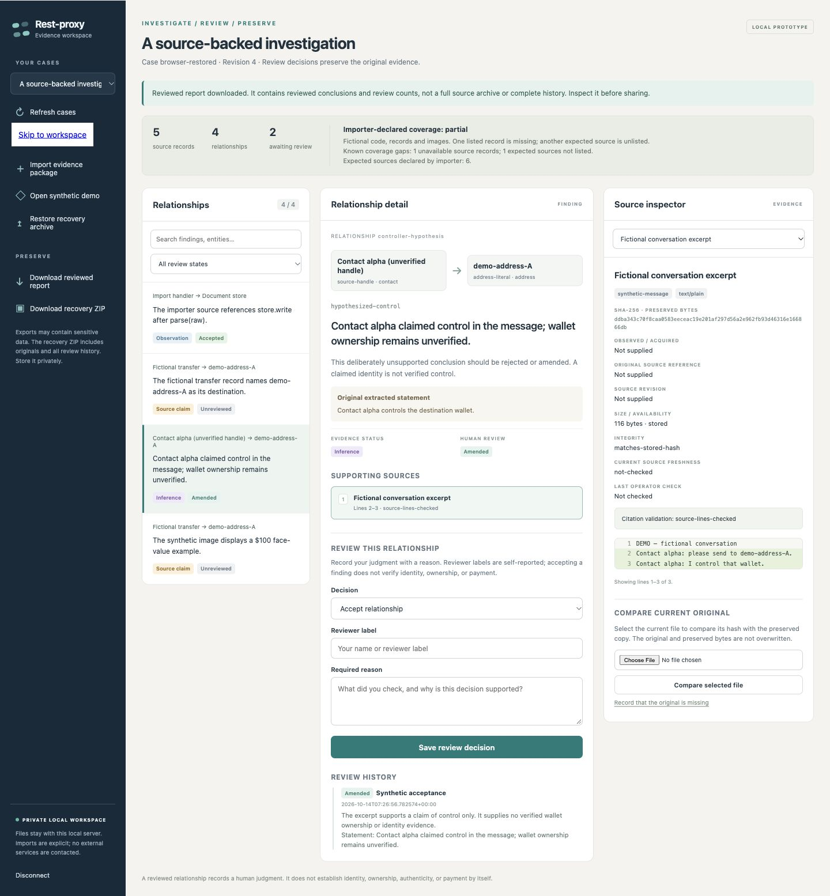

# Local evidence workspace acceptance — October 14, 2026

The first workflow passed using fictional records and private temporary state:
explicit JSON import → preserved source inspection → reasoned review/correction →
dated supplied-copy check → reviewed report and recovery ZIP → new-ID restore.
Viewer restart retained original bytes, reviews and checks. No private fraud-case
records, account credentials or real contacts appear in this evidence.

## Executable acceptance

| Check | Result |
|---|---|
| `test_evidence_workspace.py` | 33 passed |
| `test_evidence_workspace_http.py` | 17 passed |
| `test_evidence_workspace_launch.py` | 7 passed |
| `node scripts/check_evidence_workspace_ui.cjs` | 6 passed |
| `test_distribution.py` | Wheel/sdist and isolated no-Pillow import passed |
| `test_fire_store.py` | 6 passed; existing Pydantic-path unclosed-SQLite ResourceWarning observed |
| CI production Ruff scope | Passed |
| `bash -n scripts/run_ci_checks.sh` and `git diff --check` | Passed |

Storage checks include exact originals, citations/quotes, image region bounds,
amendment retention, concurrent revision conflicts, corrupt originals, private
permissions and malicious archives. Aggregate metadata and escaped-report budgets
are enforced before committing a new event, preserving a usable recovery packet.
Restore rejects hash-consistent packets with inconsistent canonical reports,
unsafe paths, duplicate members, unsupported compression or invalid citations/history.

HTTP checks cover exact Host/Origin, actual loopback client, per-launch capability,
duplicate/malformed auth and JSON, body budgets, protected source bytes and complete
import/review/check/report/backup/restore. Frontend delayed-response tests prevent
disconnected requests from restoring case names, content or downloads; verbatim
package import keeps duplicate fields visible to the strict server decoder.

Launch tests create only their own temporary ephemeral loopback process. The
SIGTERM regression verifies exit 143, removed owned launch file and retained case
database. Other tests refuse stale files, symlinks, hardlinks and overlapping owners.
The broad daemon-managed CI gate was not run against existing operational services.
The 57 workspace tests and six frontend checks also passed from an isolated copy
of exactly staged source, excluding the unrelated working-tree edits.

## Browser acceptance

A dedicated in-app browser tab exercised the standalone viewer. It imported a
selected JSON file, accepted a cited source-reference observation, amended a
wallet-control inference to a qualified source claim, inspected PNG region bounds,
and compared a selected copy with the preserved original. The immutable evidence
type remained `inference`; the reviewed wording is separate.

After restarting the owned viewer with a fresh capability, revision 4 persisted.
The downloaded ZIP restored as `browser-restored` alongside `demo-workflow`.
Direct store verification established equality of immutable baseline, original
bytes and all three review/check events. The downloaded restored report matched
canonical rendering, retained the correction and dated source check, and excluded
the original unsupported ownership statement. Both browser exports are synthetic.

Desktop layout was checked at 1440×1000. At 390×844, document client width and
scroll width both measured 390; temporary viewport overrides were reset afterward.
Browser error/warning logs were empty. Functional checks are not latency, token,
investigation-quality or identity-attribution measurements.

- [Machine-readable receipt and source hashes](receipt.json)
- [Reviewed report](reviewed-report.md)
- [Synthetic recovery ZIP](synthetic-recovery.zip)
- [Desktop screenshot](review-desktop.png)
- [Mobile screenshot](review-mobile.png)
- [Launch, contracts and limits](../../../../docs/evidence-workspace.md)

## Remaining product work

The local viewer and source contract are a prototype. Account/media acquisition,
GraphRAG query integration, encrypted recovery, shared-service identities and
independent chain-of-custody controls require separate implementation. A reviewer
label is self-reported; accepting a relationship does not establish source
authenticity, identity, wallet ownership or payment. Next select one bounded real
investigation and measure traceability, missing evidence and review effort.
