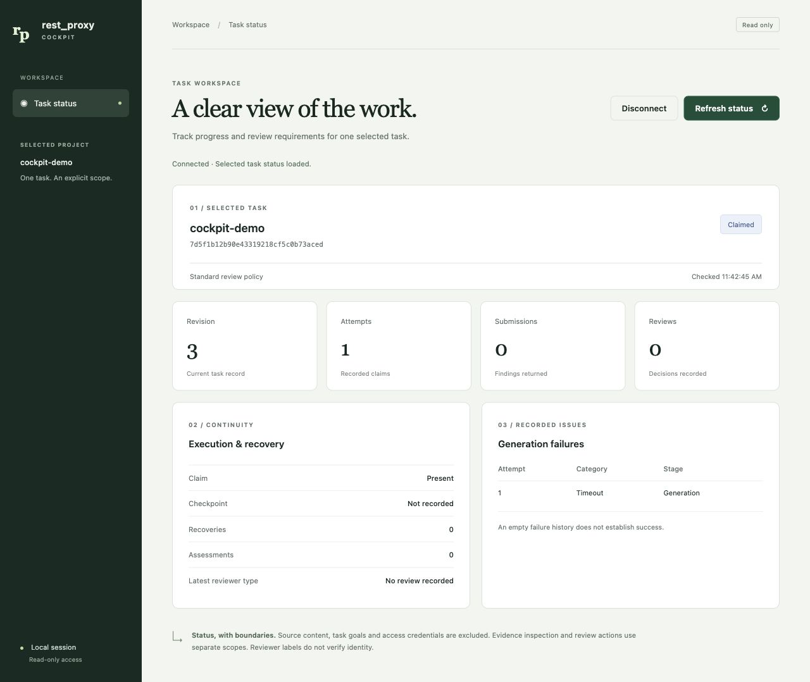
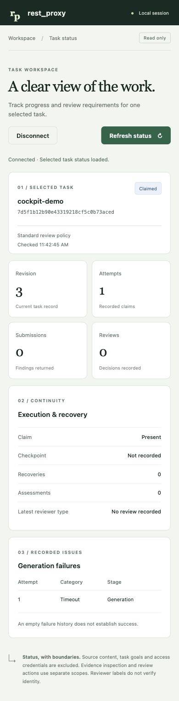

# Local Task Cockpit acceptance

October 20, 2026, native arm64 Python 3.14.8, existing development environment.
This slice adds a read-only status REST adapter and static browser view over one
fixed TaskRegistry project/task. It invokes no model or dispatcher.

## Verification

- 29 Python checks: 22 API/reader tests and 7 launcher tests, with ResourceWarnings
  treated as errors. Tests cover fixed scope/authentication, sanitized projection,
  private existing state, bounded/malformed payloads, writer updates, unchanged
  database state, explicit synthetic demo, stale launch preservation and SIGTERM
  cleanup. They use only synthetic temporary registries and owned loopback ports.
  Independent review added regressions for canonical/separate state paths and
  sanitized SQLite launch failures. The launcher ignores forwarded peer headers.
- 10 Node VM checks: fragment removal before fetch, safe text rendering, stale
  fetch and JSON completion, disconnect/pagehide isolation, errors, retries,
  rejected capabilities and reconnect. These are offline frontend logic checks,
  separate from the real-browser verification below.
- Ruff passes for the changed Python; JavaScript syntax passes.
- Wheel and source distribution build offline; isolated no-dependency installation
  confirms the launcher, reader and all static assets are present.
- The 22 API/reader checks and original five launcher checks also pass against
  the committed HEAD registry loaded in isolation, including spawned CLI
  subprocesses, without relying on unrelated working-tree registry additions.

## Real browser

A new synthetic registry and empty workspace were created outside Git. One owned
loopback listener on an unused port served the app. The browser removed its launch
fragment, loaded the queued task, then **Refresh status** displayed a normal
registry writer's new revision 3, claimed state and one synthetic timeout.
Disconnect hid the selected task and disabled refresh; manual reconnect restored
the same fixed task. No personal tasks or evidence were loaded.
After the launcher fixes, only this owned viewer was stopped and relaunched in
existing-state mode with a separate private runtime. The browser reopened the
same synthetic task successfully through the final launcher.

Desktop width 1280 and phone width 390 rendered without horizontal overflow;
the default narrow browser width was also visually inspected. Temporary viewport
overrides were reset. The screenshots contain only synthetic task metadata:

The MCP daemon, repository index and inference configuration were not changed.
No external model call, cloud upload or global extension change was needed.
This establishes the bounded local prototype's checks, not production readiness,
validated findings, verified reviewer identity or measured token/time savings.
Separately scoped evidence inspection, worker execution and remote team identity
remain future work. See [usage and boundaries](../../../../docs/task-cockpit.md).
