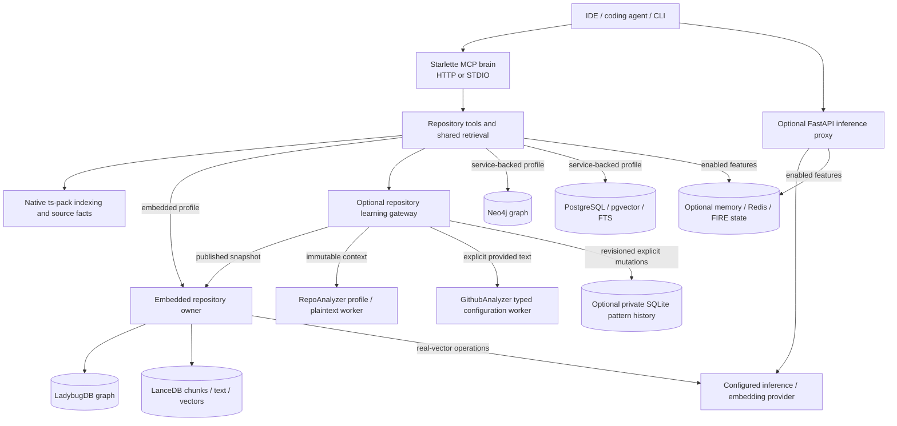
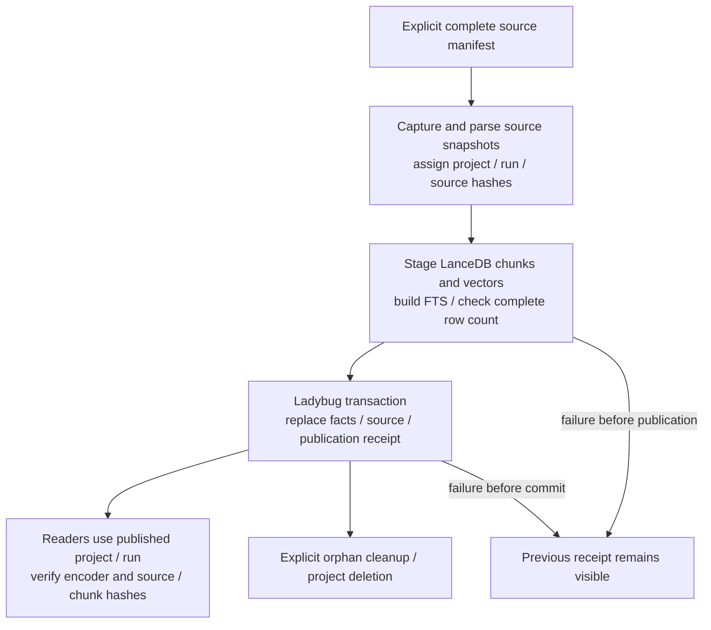
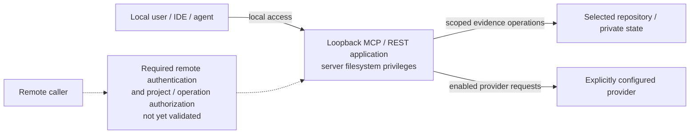

# Current architecture

**Canonical operating guide, updated October 16, 2026.** This guide describes the
current source and its documented acceptance limits. Dated studies, implementation
milestones and benchmark reports remain evidence for their recorded revisions;
their old next steps do not override this guide or the active
[delivery roadmap](next-session-roadmap.md). A local working-tree implementation
and its fixture acceptance are not a deployed release or a production certification.

## Product and application boundaries

`rest_proxy` supplies repository evidence and investigation tools to coding agents.
**FIRE — Find, Integrate, Retrieve, Explain** names the evidence and continuity core.
**GOOFY — Graph-Oriented Operations For You** is a proposed name for the assistant
or workflow built on that core. It does not rename the package, API routes, MCP
tools or storage selectors, and does not imply an implemented autonomous supervisor.

The repository has two independent application entry points:

- `brain_server:app` hosts MCP through Starlette at `/mcp`, with process/transport
  health and opt-in embedded REST evidence reads. `mcp_server.py` supplies STDIO
  MCP and command-line indexing/bootstrap operations.
- `proxy:app` hosts the optional FastAPI inference compatibility API. It forwards
  model requests to the selected provider and can use separate memory/context
  features. Improving the repository tools does not require changing that provider.

The source-tree shared MCP daemon normally uses loopback port **8001**. The optional
inference proxy normally uses loopback port **8000**. The Compose appliance also
uses host port **8000** by default, but starts **`brain_server:app`**, not the inference
proxy. Select distinct ports when running those profiles together.

See the [HTTP brain](../brain_server.py), [STDIO/CLI entry](../mcp_server.py),
[inference application](../proxy/app.py) and
[Docker entrypoint](../scripts/docker_entrypoint.sh) for the executable boundaries.

The FastAPI lifespan owns provider HTTP clients, enabled memory-pool startup/close
and its supervisor PID file. Provider clients are reused by provider/timeout within
the application event loop; helper calls outside that lifespan retain scoped
clients. HTTP reuse and cleanup are implemented resource contracts, not measured
latency improvements. The independent local embedding provider retains its own
client ownership. See [HTTP client ownership](../proxy/http_clients.py).

## KISS operating principles

**KISS — Keep It Simple and Secure** guides engineering decisions for FIRE and
GOOFY. Choose the fewest components that preserve evidence, scope, recovery and
the required behavior.

- **Select an explicit environment for each job.** Keep the working `.venv` for Rest-proxy.
  Introduce a separate analysis environment when a demonstrated dependency need
  warrants it. Track background processes separately from environment selection.
- **Keep one embedded owner.** Route clients through the existing owner. Independent
  analysis can run as tracked background jobs with bounded resources, completion
  status and captured failures; it must not independently open live embedded state.
- **Follow one evidence path.** Preserve originals, extract syntax or structured
  facts, record cited relationships, then retrieve and explain. Keep source hashes,
  spans and provenance when simplifying orchestration. Separate observations from
  ownership, runtime-resolution and attribution hypotheses.
- **Extend bounded interfaces.** Add narrow source adapters and explicit operations
  to the shared evidence contracts. Add services, frameworks or storage engines
  when a demonstrated requirement justifies their operational cost.
- **Deliver one verifiable workflow at a time.** Define the expected result and
  relevant failure checks before expanding. Keep personal investigation records
  in a separate private case store outside Git and ordinary repository indexes.

## Syntax, graph evidence and repository learning

Repository intelligence uses several representations of the same source. Embeddings
support similarity retrieval; syntax, relationships and learned repository patterns
support questions that similarity alone cannot answer.

| Representation | Current role | Evidence boundary |
| --- | --- | --- |
| Original source | Exact excerpts, hashes and source locations | The retained source is the basis for checking derived claims. |
| Syntax structure | Native ts-pack parses source and extracts declarations, imports, calls and syntax-aware chunks | Tree-sitter produces a concrete syntax tree; extraction preserves selected facts, not every tree node. |
| Structural graph | Symbols, containment, dependencies and typed evidence relationships | A syntactically observed call is not proof of its runtime target. Resolution and publication provenance matter. |
| Text and vectors | Lexical, vector and hybrid retrieval over chunks | A text embedding does not automatically encode the AST or prove structural relationships. |
| Repository learning | Related analyzers extract and reuse code, documentation, architecture and convention patterns | Parser coverage, pattern evidence and recommendation quality need their own acceptance. |

The embedded path parses and captures structural source evidence before creating
and embedding chunk text. See [source extraction](../graphrag_core/indexing/embedded_outlines.py),
[parser facts](../graphrag_core/indexing/embedded_facts.py) and
[repository publication](../graphrag_core/indexing/embedded_repository.py).
The server path similarly separates structural indexing from semantic publication.

**RepoAnalyzer** owns repository pattern learning and transfer. Its reference workflow
extracts code, documentation and architecture patterns, persists them and produces
recommendations. Code artifacts can retain an AST and an optional embedding; its
custom plaintext parser also converts pattern matches into document nodes with
source locations and relationships. This is broader than code-vector search.
Its lightweight local context adapter has different extraction coverage, so the
existence of an AST parser does not establish AST coverage for every ingestion path.

The optional [repository learning integration](repository-learning.md) calls
RepoAnalyzer's indexed-payload profile/comparison APIs against captured embedded
publications through shared MCP and REST. Explicit learning mutations additionally
retain normalized declaration/naming/language pattern artifacts, a historical profile
and immutable source-hashed context in private SQLite memory. Exact publication-run
and memory-revision checks fence commits; historical context survives embedded
deletion/reindex. Supplied plaintext uses RepoAnalyzer's actual authored regex
extraction/node factory to retain a bounded custom document AST. Full parser/adaptive/
AI initialization is excluded; relationship templates are not resolved graph edges.

**GithubAnalyzer**'s integrated slice invokes its actual requirements/gitignore
components against explicit provided text. Fixed unmodified source files are hashed
and loaded in disposable scratch, without broad package startup, database stubs or
repository acquisition. Typed declarations are not dependency solving/effective
ignore evaluation. Plaintext/configuration originals remain private and carry
`provided-text` provenance rather than current repository-fact status.

`LM_PROXY_REPOSITORY_LEARNING_STATE` explicitly enables private memory and mutation
tools. `/evidence/read` serves learning inspections/suggestions; `/learning/write`
permits only the four explicit learning/delete operations. Tombstone deletion removes
retained payloads while keeping the monotonic revision fence. Worker/input/output
bounds and optional backend roots remain explicit. Trusted-code guards are not an
OS sandbox; adaptive training, full analyzer runtime adoption and outcome gains
are not established. See the
[persistent acceptance](../benchmarks/reports/2026-10-12/persistent-learning/README.md).
The
[current-source investigation](../benchmarks/reports/2026-10-11/ast-learning.md)
records the observed paths, hashes and a possible loss of AST children in
GithubAnalyzer's active serializer.

Future integration and telemetry must preserve source identity, parser/backend
version, source spans, relationship resolution and pattern origin independently
from embedding identity. Evaluate nested declaration/call coverage, plaintext
structure and recommendation evidence as well as retrieval quality. Pattern
extraction and reuse do not by themselves establish model training or better coding
outcomes.

## Storage and deployment profiles

| Profile | Application | Storage / provider requirements | Current boundary |
| --- | --- | --- | --- |
| Local embedded repository tools | One MCP brain owner over HTTP or STDIO; optional REST evidence reads | LadybugDB and LanceDB in an explicit private state directory; modified native parser. Published source, overview, text search and manifest freshness need no model or external database servers. Real-vector indexing and vector/hybrid search use the configured local encoder. | Supported explicit tools and existing query bridges; incomplete application/query parity. |
| Service-backed repository tools | MCP brain over HTTP or STDIO | Neo4j for graph tools and PostgreSQL/pgvector for retrieval; Redis only for features that enable it. | Existing service-backed indexing, retrieval and memory workflows. |
| Compose MCP appliance | `brain_server:app`, exposed on loopback by default | Neo4j, PostgreSQL/pgvector and Redis containers; bootstrap precedes application startup. | Service-backed development appliance; `/ready` requires read-only connectivity checks for the three declared services. |
| Optional inference proxy | Separate `proxy:app` process | Configured inference endpoint; memory/persistence dependencies only for the enabled features. | Independent compatibility layer; selected repository storage does not make all inference-memory paths backend-neutral. |
| Combined local workflow | MCP brain plus optional inference proxy on distinct ports | Requirements of the selected repository profile plus the selected inference features. | Both applications can be used; running both database stacks is unnecessary. |

LM Studio fits the optional **model-serving layer**. Its desktop app or headless
llmster can host models; `lms` is their CLI. Generation and embedding model selection
are independent of the evidence/storage profile. Runtime KV caches are distinct from
durable FIRE originals and task state. The current provider and strict encoder have
specific contracts; a documented vendor feature is not automatically an integrated
repository feature. See [LM Studio integration](lm-studio.md).

The October 16 [stack/context research](stack-and-context-strategy.md) and
[persistent-context roadmap](persistent-context-roadmap.md) retain these profiles.
They propose acknowledged archival, complete-exchange windowing and recovery gates
through existing FIRE/context interfaces. A ring does not enlarge model attention
or establish full-history recall. These documents do not activate runtime settings,
move data or establish a distributable LM Studio license.

Select embedded repository storage with `LM_PROXY_STORAGE_BACKEND=embedded`,
`LM_PROXY_GRAPH_BACKEND=ladybug` and `LM_PROXY_EMBEDDED_STATE`. Disable separate
legacy memory, external persistence and Redis paths for the storage-only profile.
Configuration changes select behavior; they do not migrate existing data. Use the
[configuration guide](configuration.md), [minimal installation](minimal-embedded-install.md)
and [embedded owner setup](embedded-mcp-owner.md) for exact options.

Compose and live graph CI share the Neo4j **5.26** baseline. Its minor image tag is
still mutable, so patch/digest reproducibility remains separate work. Compose does
not load APOC or grant unrestricted APOC procedures. Omitted `LM_PROXY_NEO4J_DB`
selects `neo4j`; an explicit existing database name such as `proxy` remains honored.
The default change does not rename or migrate existing databases or rewrite `.env`.

The service-backed graph and vector stores have separate jobs and publication
identities. Structural shadow runs and successful promotion protect graph visibility;
semantic status records its target structural run. Alignment/freshness checks are
still necessary. Do not interpret a successful graph run as an atomic commit across
Neo4j and PostgreSQL. PostgreSQL lexical ranking uses native full-text `ts_rank`;
it is not a BM25 implementation. See the
[indexing pipeline](../scripts/index_workspace.py),
[structural shadow publication](../graphrag_core/indexing/shadow.py) and
[service retrieval](../memory/store_search.py).

## Embedded ownership and publication

One lazy process runtime owns the combined graph/vector repository and serializes
its operations. Serve multiple clients through that owner. Independent HTTP and
STDIO processes cannot own the same embedded state directory simultaneously.
Engine locks enforce local ownership; they are not distributed leases or tenant
authorization. Application shutdown drains/closes the runtime.

The **graph publication receipt is the visibility switch** after vector staging.
This is a coordinated publication protocol, not a distributed transaction between
the engines. Readers filter LanceDB by the published project/run and check evidence
hashes. Indexing replaces the complete explicit manifest: omitted paths disappear
from the next publication. Staged unpublished runs may remain physically present
after failure. Cleanup excludes readers through the owner; deletion hides graph
visibility before removing vector rows. Reconcile the receipt after ambiguous
cancellation around commit.

The owner records indexing attempts separately from the active publication. A
failed latest attempt can coexist with a usable older publication. Fixture
crash/reopen and cold restore checks do not establish an operational backup schedule,
retention/deletion policy or power-loss guarantees for every deployment. Source:
[combined owner](../graphrag_core/indexing/embedded_repository.py),
[process runtime](../memory/embedded_runtime.py),
[publication evidence](../benchmarks/reports/2026-10-04/embedded-run-publication.json)
and [restore acceptance](release-inventory-and-restore.md).

## Trust boundaries

The supported local boundary uses loopback listeners. MCP session identifiers,
tool profiles, project selectors and evidence hashes do not authenticate a user
or grant authorization. Tools inherit the server's filesystem privileges. No
validated general inbound authentication/project authorization layer is established
for shared remote use; retain loopback access until that boundary is implemented
and tested. Compose keeps database ports internal and publishes the application
on `127.0.0.1`.

Agree permitted source paths, processing location/providers and retention before
customer data is processed. Include only the needed evidence; exclude credentials
and unrelated records. Use disposable fixtures for acceptance writes. A snapshot
hash proves byte identity, not correctness, freshness or reviewer identity.
[Dependency security](security.md) tracks advisory/scanner debt separately from
application authorization. See [Compose](../docker-compose.yml),
[session middleware](../brain_server.py) and
[embedded owner limits](embedded-mcp-owner.md).

## Implemented coverage and acceptance limits

| Surface | Current behavior | Limit |
| --- | --- | --- |
| Embedded explicit tools | Source/outlines, overview, project discovery, graph/vector publication, retrieval and static relationships; metadata, indexing journal and IDE/watch features have specific acceptance records. | Static calls/imports/routes are candidates; dynamic behavior and complete language/query parity are not established. |
| Standard indexing | `index_workspace` remains the service-backed pipeline. | Embedded selection guards the legacy workers; use the explicit complete-manifest embedded indexing tool. |
| Authored-document retrieval | Existing PostgreSQL/embedding pipeline. | Not an offline embedded universal document importer. |
| Application health | `/live` checks process response; `/ready` checks lifespan startup plus explicitly required dependencies; `/health/details` describes that readiness scope. Existing `/health` remains compatible. | MCP defaults to transport only; inference defaults to provider model-catalog connectivity. Readiness does not establish storage integrity, model generation or full tool parity. |
| Operational telemetry | Optional private OpenTelemetry request/tool spans and fixed-label duration/count metrics; embedded parser/facts, graph/vector, publication, analyzer and learning-persistence boundaries. | Default disabled; explicit collector export. Pool acquisition, full PG/Redis/provider/legacy-index coverage, operational SLOs and measured improvements remain open. See [setup and scope](telemetry.md). |

The separate [architecture/ARM implementation receipt](../benchmarks/reports/2026-10-11/architecture-arm/README.md)
records the current cleanup/resource/ARM change acceptance; its results also remain
bound to the stated source hashes and validation scope.

See [health and readiness](health.md) for dependency selection, deadlines and caching.
Readiness probes do not bootstrap schemas, open embedded owners or load models. An
explicitly required embedded owner remains unready until an operation initializes
the existing process runtime; optional integrations still fail open on request paths.

## Runtime, ARM and measurements

The package compatibility floor is **Python 3.11**; **Python 3.14** is the reference
CI/appliance runtime and recommended development version. This does not mean all
optional dependencies and native engine combinations are validated on every
Python version or platform. Ruff is a required production CI check; use the existing
working `.venv` and select relevant focused checks before broader service-changing
gates. See [runtime setup](python314-runtime.md) and [evaluation](evaluation.md).

Recorded macOS ARM64 acceptance uses native parser/storage packages. Native
execution establishes platform compatibility; it does not establish application
speedup, CPU/GPU/Neural Engine utilization or better coding outcomes. Embedding and
generation acceleration belong to the configured model runtime and require their
own measurements. Broader native builds/installs and ARM workload evidence remain
explicit acceptance work rather than assumptions.

Ladybug's native CPU thread budget is configurable with
`LM_PROXY_LADYBUG_THREADS` (integer 1..64, default 2). The driver accepts an explicit
`max_num_threads` override, and the combined owner forwards `graph_threads` when
provided. This changes an engine budget; application operations still pass through
the shared owner. Measure the actual workload before tuning it, independently from
model-runtime acceleration.

The [native ARM CI matrix](../.github/workflows/ci.yaml) is configured for
`macos-15` and `ubuntu-24.04-arm`, checks the actual process architecture and builds
the pinned parser wheel inside each job before installing the minimal core/embedded
profile. This configuration still needs successful hosted runs; an x86 wheel or a
previous local receipt does not attest either runner.

[Runtime fingerprints](../scripts/runtime_hardware.py) record Python/native binary
architectures, artifact hashes and bounded hardware fields.
[The disposable benchmark](../scripts/benchmark_embedded_arm.py) sweeps Ladybug
thread budgets using reproducible fixture sources, real parser/storage engines and
synthetic vectors by default. It records cold/warm indexing, bounded text queries,
process peak RSS, disk usage and publication/source integrity. Here, cold means a
fresh process and empty state, not cleared OS/parser caches. Real-encoder measurement
is an explicit option requiring an already loaded model and artifact identity.
These observations do not measure SIMD/GPU/Neural Engine execution, establish an
ARM-versus-x86 speedup or demonstrate semantic investigation quality.
See [ARM validation and reproduction](arm-validation.md) for the explicit manifest
mode, command examples and retained local observations. The tiny fixture results
do not justify changing the default two-thread budget.

The [October 3 paired pilot](../benchmarks/reports/2026-10-03/README.md) measured a
smaller serialized MCP catalog but did not establish lower end-to-end latency or
tokens. Storage fixture parity also does not establish that Ladybug/LanceDB is
faster than Neo4j/PostgreSQL. Promotion requires representative fixed source/query
corpora, correctness/recall, indexing and p50/p95 latency/resource measurements,
restart/restore behavior and controlled paired investigation outcomes, including
native fallbacks and setup/review/correction effort.

## Next decisions

Keep the embedded local path and service-backed baseline explicit. Complete a
useful revision-bound investigation/walkthrough and record the observed delivery
costs. Fix a concrete blocker at its owning layer. Broad database migrations,
new graph plugins, framework expansion and provider changes are separate decisions
that require a workload or delivery need. The [active roadmap](next-session-roadmap.md)
defines the current next outcome;
historical research recommendations are not a parallel implementation queue.
