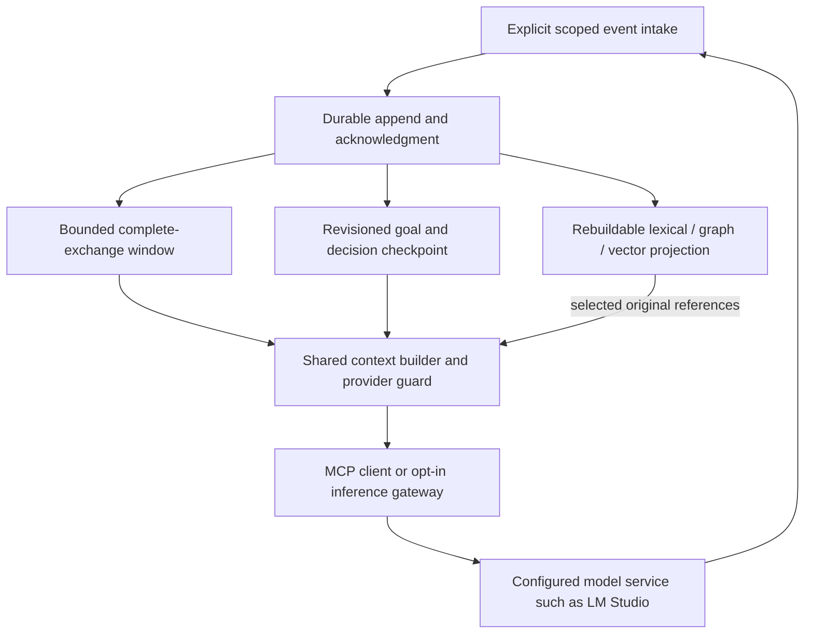

# Persistent context implementation roadmap — October 16, 2026

Status: planning, not implementation acceptance. The user requested documentation,
research and a roadmap. This document does not authorize model calls, runtime changes,
publishing, migration or automatic capture of unrelated conversations. It extends the
[stack decision record](stack-and-context-strategy.md) and the [active roadmap](next-session-roadmap.md).

## Intended outcome

One scoped investigation can continue after recent messages rotate out and after a
process restart. It recovers the latest goal, constraints, corrected decisions and
supporting originals, and supplies relevant evidence within the actual model request
budget. Missing/expired evidence, archival failure and uncertain freshness remain
visible. Recovery does not promote retrieved text into new user instructions.

Success means demonstrable continuity for defined tasks, not an infinite attention
window, unlimited retention or perfect recall. The current next delivery remains one
useful, revision-bound investigation/walkthrough. Use it to drive the bounded engineering
lane below; do not run every conditional stack evaluation in parallel.

## Architecture to evaluate

This is the proposed flow. Existing FIRE snapshots, context bundles and an opt-in
LM Studio forwarding route implement parts of it; automatic event intake, archive
watermarks, coordinated eviction and verified recall are not established.

## Sequencing and completion gates

| Phase | Deliverable | Dependency | Completion evidence |
| --- | --- | --- | --- |
| 0 | Pinned continuity workload and architecture decision | Documentation/source inventory | Source identities, exact capture/scope/retention contract, baseline and agreed resource/quality limits. |
| 1 | Acknowledged event archive and safe window lifecycle | Phase 0 | Crash/retry/outage/stream/cached-continuation checks; no false saved status; original recovery after eviction. |
| 2 | Checkpoint recovery, corrections and targeted recall | Phase 1 | Restart with chat removed; source-cited old fact recovered; obsolete decisions suppressed; wrong-scope and unavailable evidence disclosed. |
| 3 | Complete request budget and explicit provider integration | Phases 1–2 | Full payload plus reserves fits verified accounting; intact tool exchanges; overflow refuses before inference; no duplicate injection. |
| 4 | One bounded local end-to-end investigation | Phases 1–3 | Reproducible recovery run, graded answer/citations, actual provider observations and retained sanitized receipt. |
| 5 | Controlled outcome comparison | Phase 4 | Comparable baseline/treatment trials including setup, retrieval, corrections, review, elapsed time and actual usage/cost. |
| 6 | Selected deployment/distribution profile | Evidence of need from Phases 4–5 | Exact artifacts/licenses, install/reopen/restore, observability and profile-specific deployment checks. |

These are dependency gates, not calendar promises. Local functionality can be accepted
without the paid comparison or distribution work, provided its narrower scope is stated.

### Phase 0 — define the observable contract

Use a frozen rest_proxy source snapshot and disposable conversations for the first
fixture. Include an early distinctive fact, a later correction, a source-backed
decision, an unresolved question and a complete tool exchange. Make the conversation
exceed the chosen active-window allowance. Record explicit project/session/task IDs,
model capacity, token accounting method, tool schema sizes and permitted source scope.

Decide the authoritative append format: stable event ID, sequence, scope, role/kind,
complete exchange links, source hash/reference, correction/supersession, capture status
and archive acknowledgment. Distinguish request accepted, partial stream observed,
generation completed, and original durably stored. Do not record an interrupted
stream as a completed assistant answer or re-run inference during archive replay.

Compare extending the existing FIRE SQLite store with adding an append-only event
table behind the same scoped interface. Its current 128,000-byte original snapshot
cap and one-day default / 30-day maximum retention must remain explicit until a
versioned replacement is designed. Do not rewrite entire growing transcripts into
each checkpoint or put unbounded bodies in a ring. Keep one embedded graph owner;
the append store is a separate responsibility with explicit lifecycle ownership.

Set archive byte/event/retention quotas, active-window byte/token/exchange limits,
retrieval candidate/output budgets and recovery latency expectations before testing.
Do not invent a universal optimum. Keep the existing working runtime and model as
the first baseline; no provider/database migration is needed to define this contract.

### Phase 1 — persist before acknowledged eviction

Implement explicit, scoped event capture for the selected client path. Cover ordinary
responses, cached provider continuations, complete tool exchanges and streaming
completion/cancellation as separate cases. Use idempotent IDs and transactionally
acknowledged sequence/watermark state. A ring/deque stores the active working set
or references to committed originals; a max-length container alone is insufficient.

Advance the recoverable watermark only after durable commit. On duplicate delivery,
reuse the stored event; reject the same ID with changed content. On storage failure
or quota exhaustion, expose unavailable/full/continuity-degraded status and any known
loss range. Inference must remain usable when optional memory is unavailable. It
must not report unsaved events as recoverable. Bounded resources, continued intake
and zero loss cannot all be promised under an indefinite archive outage.

Acceptance covers failure before commit, failure after commit but before reply,
duplicate replay, competing scope/sequence writes, cache loss, full storage and
interrupted streams. Reopen from a separate process. Verify acknowledged originals
and hashes survive; verify no memory failure breaks the ordinary proxy response path.
Use explicit bounded capture operations rather than assuming access to an external
client's hidden context or internal compaction hooks.

### Phase 2 — recover current state and the right originals

Reuse FIRE's revision comparison, correction origins, historical-original paging,
expiry/deletion and snapshot-to-bundle adapter. Keep the current goal, constraints,
decisions, open questions and next actions independently recoverable from recent turns.
Fix the legacy old-items-first summary cap before using that path to track changing
state. Summaries point to originals; they are not the only record of an accepted fact.

Start retrieval with exact source/event IDs, current scoped checkpoint and bounded
lexical search. Add existing graph/vector retrieval only for questions that benefit.
Record query/candidate identities, selected citations and explicit omissions. Preserve
correction history but select current decisions; do not replay a superseded constraint
as an instruction. Repository evidence and conversation history retain distinct
freshness meanings. A stored hash verifies identity, not current disk/editor state.

The defining drill is: save an early fact and its original, exceed the window, remove
the fixture conversation, restart, ask a question requiring that fact, and recover
it with a correct original citation. Repeat after a correction, source edit/deletion,
expiry and archive/index outage. Wrong project/session/task must not reveal it.
An embedding outage must still permit exact/source/text recovery where supported.
Record misses and unavailable originals rather than infer successful recall.

### Phase 3 — one request budget and explicit runtime ownership

Reuse `memory/context_bundle.py` and `proxy/context_forwarding.py`. Count mandatory
instructions, current goal/messages, tool schemas, checkpoint, recent exchanges,
retrieved evidence, provider framing/held context, output reserve and safety margin.
Preserve whole citations and complete tool-call/result groups. Mandatory overflow
must produce a clear diagnostic before inference, not silent loss of trusted content.

Verify the selected model/tokenizer/chat-template configuration against the actual
serialized provider request. Preserve byte-estimate labeling until exact accounting
is established; compare provider-reported usage with estimates without calling the
provider report independent metering. Recheck loaded capacity/model identity and
record lifecycle races. No model loading/unloading or configuration tuning is part
of a normal evidence request.

Retain current stateless/text-only/non-streaming forwarding as the first accepted
surface. Streaming, multimodal input and provider-held continuation require separate
contracts and gates. Prevent legacy injection from adding the same history/bundle
again. An MCP client owns its own final request; expose accurate bundle/omission
metadata without claiming control over hidden client context.

### Phase 4 — one local workflow proof

Run the complete accepted path on the disposable fixture and one bounded repository
question. Use the already approved runtime only when an execution brief authorizes
the calls; budget requests/output and define stop conditions in advance. Confirm a
prior timed-out inference ended before any explicit retry. Retain failed attempts.

Capture exact source/model/encoder/tokenizer identities, archive and checkpoint
revisions, original citations, selected/omitted IDs, observed prompt/completion usage,
elapsed stages, memory/disk footprint and restart results. Review the answer and
limitations against current source; the pinned sum-fixture acceptance is not approval
of an arbitrary investigation. Publish only sanitized receipts, not private originals.

Completion requires the early-fact recovery drill plus truthful failure behavior,
one current-source answer and a reproducible handoff. No latency/token/quality advantage
is inferred from that single functional success.

### Phase 5 — measure whether memory improves the investigation

Compare baseline and continuity-assisted runs on the same pinned questions/repository,
with the same model, generation budget, tools and retrieval policy where possible.
Use fresh sessions and counterbalance trial order. Predeclare the expected source
evidence and grading rubric, repeat enough trials to expose variability, and retain
errors/native fallbacks. Keep functional-fixture and real investigation results separate.

Measure answer correctness, source/citation accuracy, stale claims, recovery/omission
rates, actual provider or billed usage, total elapsed time, and setup/review/correction
labor. Local provider token counts are not evidence of paid-provider charges. Run a
paid-provider comparison only with an explicit spending scope. Report tradeoffs and
uncertainty; no savings claim follows from a smaller ring or a passing schema check.

Only improve the measured bottleneck. Profile archive I/O, retrieval, serialization,
model inference and window maintenance separately. Evaluate a C/PostgreSQL ring only
if its workload dominates enough to justify maintenance and acceptance costs.

### Phase 6 — package the profile that has a demonstrated role

Keep the local embedded profile (one owner, Ladybug/LanceDB and SQLite continuity)
distinct from the service profile (Neo4j/PostgreSQL and enabled optional cache). Test
backup/restore and schema evolution for the selected archive; configure quotas and
retention explicitly. SQLite WAL is a choice requiring its own concurrency/backup
checks, not an implied change in this roadmap.

Keep LM Studio as an optional user-supplied internal/development adapter. Evaluate
llmster for a headless requirement after confirming its exact distribution terms.
Evaluate llama.cpp/MLX LM only for engine-control, packaging or measured hardware
needs; FastEmbed/TEI only for an embedding requirement. Compare the same model and
preprocessing when feasible, disclose incompatibilities, and never mix vector spaces.
Verify model licenses and exact shipped artifacts separately from engine/CLI licenses.

For real remote HTTP exposure, select and test an edge, authentication/authorization,
streaming/timeouts and operational recovery. For a useful metrics workflow, route
existing OpenTelemetry through an explicitly configured collector/backend. No Kafka,
NATS, Kubernetes, service mesh or ELK installation is a prerequisite to local continuity.

## Status ledger and boundaries

Implemented foundations are source-bound in the [decision record](stack-and-context-strategy.md).
The October 6 receipts cover explicit recovery, bundle assembly and one historical
real-model forwarding case; current forwarding bytes differ. Later telemetry,
evidence-workspace and corpus receipts cover their own scopes. None is a new test
of this full roadmap. Current legacy persistence/scoping/summary/tool-exchange gaps
remain open until separately implemented and validated.

The separate PR #4 review-policy candidate passed 113 offline tests and one disposable
pinned provider fixture in its isolated worktree on October 16. It is uncommitted and
unpublished. That work is not a context-memory benchmark; this planning update neither
commits it nor changes its retained human/automated review records.

This task delivers the research documents, corrected documentation examples, source
receipt and documentation checks. No new ring/archive implementation, background
capture, service/model/index/configuration change, dependency installation or Git
publication is included. The first implementation brief should take Phase 0 and
one bounded slice of Phase 1, with its exact capture and failure acceptance defined.
