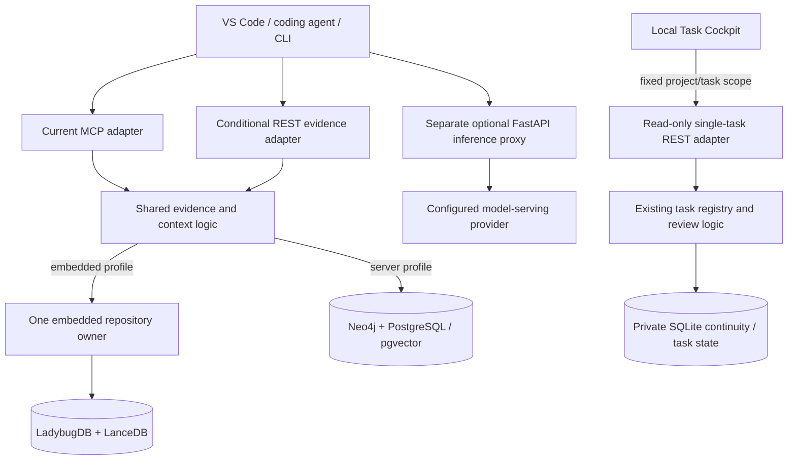

# Rest-proxy as a product stack

Rest-proxy already has a backend and APIs. A **stack** is the set of components
that delivers a complete workflow: interface, API, application logic, storage,
optional workers and operations. A rental platform might connect a booking screen
to availability and payment services. Here, the interface requests an investigation,
the backend retrieves cited evidence, and a reviewer decides what the result supports.

| Rental-platform layer | Rest-proxy equivalent | Current boundary |
| --- | --- | --- |
| Customer or staff interface | VS Code, coding agents, CLI; local Task Cockpit | Editor integration and a bounded status screen exist; a complete Cockpit application is not established. |
| Backend API | Starlette MCP brain; selected REST adapters | Multiple explicit surfaces, rather than a finished universal product API. |
| Business logic | Evidence retrieval, indexing, context assembly, task claims and review | Shared Python modules with separate configuration and acceptance contracts. |
| Database | Selected repository storage plus private continuity/task stores | Embedded and server profiles are alternatives, not mandatory parallel installations. |
| External service | Optional model-serving provider | Generation and embedding are independent capabilities; source reads can need neither. |

The [current architecture](current-architecture.md) defines the operating boundaries
and the storage profiles that make up this stack.

## Components and ownership



The HTTP [brain application](../brain_server.py) mounts MCP at `/mcp` and normally
runs on loopback port 8001. Its opt-in embedded REST adapter shares tool validation
and the same runtime; it does not create another database owner. See
[route construction](../brain_server.py) and the
[REST allowlist and dispatcher](../tools/brain/embedded_rest.py).

Embedded mode uses [one serialized runtime](../memory/embedded_runtime.py) owning
LadybugDB and LanceDB. Server mode uses Neo4j and PostgreSQL/pgvector, with Redis
only for enabled features. Neither profile makes every tool backend-neutral.
The separate [FastAPI inference application](../proxy/app.py), normally port 8000,
forwards model requests. Building a frontend does not require moving inference
providers or replacing the evidence backend.

A **client** presents requests and results. A **worker** executes an explicitly
bounded task and returns a checked result. A **model** generates or embeds text
when an adapter invokes it. Installing an editor agent, connecting MCP or hosting
a model does not automatically register a worker with our task system.

## One existing API operation through two transports

For an already published embedded project, an initialized MCP client can call
`describe_embedded_file` with these arguments:

```json
{"project_id":"demo","file_path":"README.md","start_line":1,"max_lines":20}
```

With embedded storage selected, private state configured and
`LM_PROXY_EMBEDDED_REST_ENABLED=1`, a native HTTP client can instead send
`POST /evidence/read` to the same brain process:

```json
{
  "tool":"describe_embedded_file",
  "arguments":{"project_id":"demo","file_path":"README.md","start_line":1,"max_lines":20}
}
```

Both adapters reach the [same bounded source operation](../tools/brain/embedded.py).
The example assumes an existing publication; it neither creates a project nor
establishes that the running daemon has this configuration. MCP additionally
requires its initialization/session protocol. Keep transport adapters thin and
retain source hashes, spans and publication identity in the shared core.

## First Cockpit slice

The [local Task Cockpit](task-cockpit.md) now exposes
`GET /api/v1/task-status` over [`TaskRegistry.inspect`](../memory/task_registry.py)
and displays one selected task in a small browser view. It uses an existing-state
SQLite reader, fixed project/task scope, a per-launch loopback capability, bounded
output and explicit failure states. It excludes claim tokens, goals and raw source.
The explicit synthetic demo creates disposable records outside Git; normal mode
does not initialize state. The
[existing task CLI](../scripts/task_local.py) reads JSON on stdin; it is not an
authenticated HTTP endpoint. This slice adds no dispatch or approval. Separately
scoped evidence navigation and task-result review are future slices; the status
screen does not imply source validation or successful model acceptance.

Lessons and investigation cases keep independent private stores outside ordinary
repository indexes. The [lessons corpus](lessons-corpus.md) has a separate
[read-only REST application](../graphrag_core/lessons_corpus/server.py) that requires
a local bearer capability and rejects browser Origin headers. A browser frontend
therefore needs a deliberately designed access boundary; opening CORS is not an
established integration. Remote team authentication, authorization and a universal
API remain separate work. Reuse evidence and review contracts without merging
private datasets or duplicating their storage owners.
