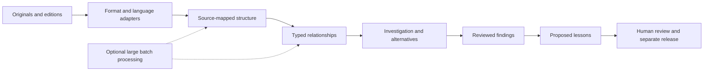

# Research corpora as repositories

Research and design assessment, October 19, 2026. The bounded
[James pilot](james-pilot.md) now implements a narrow USFM adapter, two selected
editions and attributed cross-references. Whole-library ingestion, Spark deployment
and substantive human investigation/review remain open. The
[investigation-to-lesson prerequisite](lessons-corpus-baseline.md#investigation-to-lesson-connection)
is implemented for new proposals and releases; both existing lesson proposals
remain pending legacy records.

## Repository-first representation

Reuse repository discipline for books and research: immutable originals, versioned
editions, stable identifiers, syntax trees, explicit relationships, exact citations,
dependency checks and review history. Preserve disagreement and amendments.

Keep each corpus an explicitly selected workspace. Share representation interfaces
with code repositories while retaining domain-specific node and relationship kinds.
An attributed historical claim is not a compiler-resolved call edge. Git can hold
adapters, schemas, manifests and permitted small fixtures; full captures and restricted
material remain in separately selected storage under their recorded access conditions.

## What belongs in the language layer

The existing corpus [document parser](../graphrag_core/lessons_corpus/ast.py)
preserves HTML tokens, hierarchy, link occurrences and Unicode source spans. Literal
plaintext currently becomes a document/text node, not a resolved argument or verse
tree. The [RepoAnalyzer adapter](repository-learning.md) provides another bounded
plaintext pattern AST; its relationship templates are not resolved graph edges.

The pinned tree-sitter language-pack revision
`6fcead43fc13b0049481ea5b5c491e02eab4ac68` contains XML in its language inventories,
but no separate USFM, USX or OSIS grammar entry. An XML-based scripture adapter can
reuse XML syntax parsing and supply its own schema-aware mapping. Parser runtime
availability was not exercised and no parser was downloaded by this review.

[USFM/USX/USJ](https://docs.usfm.bible/usfm/latest/introduction.html) already define
structured scripture formats. Their [milestones](https://docs.usfm.bible/usfm/latest/ms/index.html)
handle overlapping verse, paragraph and speaker boundaries. A single nested tree
cannot represent every relationship. [TEI linking and alignment](https://www.tei-c.org/release/doc/tei-p5-doc/en/html/SA.html)
also provides established approaches for references and separate annotations in
books and historical texts.

Adapters should own decoding, structure, notes, explicit references and exact spans.
Linguistic datasets can supply attributed morphology and sentence analyses. Claim
extraction, entity resolution, possible allusions and causal interpretation require
separate methods and review. A programming-language grammar bundle alone does not
establish natural-language meaning.

Keep original bytes and decoding separate from normalized search text. Preserve
maps between UTF-8 byte offsets, Unicode character offsets and displayed selections;
never silently reuse one unit as another. Hebrew right-to-left display, Greek and
Hebrew combining characters, translator notes and OCR need explicit handling.

## Passage identities and graph relationships

A passage identity should include work, edition/translation, language, canon,
versification, passage reference and pinned source version/hash. Keep manuscripts,
editorial editions, translations, footnotes and later commentaries distinguishable.
The same printed chapter/verse number need not designate the same span in every
edition; preserve split/merged and unmapped references.

| Relationship family | Examples | Evidence requirement |
| --- | --- | --- |
| Observed structure | contains, next passage, explicit reference occurrence | Exact source span and parser/mapping version. |
| Dataset/editor assertions | translation alignment, variant reading, editorial cross-reference | Dataset identity/version, attribution and alignment limits. |
| Investigative interpretation | possible allusion, same-person candidate, supports/challenges claim | Stated method, supporting/contrary evidence, uncertainty and review. |
| Lesson dependencies | derived from reviewed finding | Exact finding/review revision and hash; re-review after change. |

A graph path is an inspectable connection. Source agreement, shared vocabulary,
many cross-references or repeated retelling does not establish independent testimony.
Keep a source's own claims separate from a later investigator's assessment.

## Initial Bible and cross-reference sources

These are source candidates, not downloaded or accepted corpus contents:

| Source | Useful contribution | Recorded boundary |
| --- | --- | --- |
| [World English Bible](https://ebible.org/details.php?id=engwebp) | Public-domain English base text with structured exports. | Pin the exact edition/canon. This edition omits the Deuterocanon; the publication name has separate trademark conditions. |
| [OpenBible](https://openbible.info/labs/cross-references/) | About 340,000 editorial/thematic passage links, principally from the Treasury of Scripture Knowledge. | Cross-reference material is CC BY; displayed ESV quotations have separate copyright. Links are investigation leads. |
| [STEPBible-Data](https://github.com/STEPBible/STEPBible-Data) | Hebrew/Greek tags, lexical data, variants, names and versification mappings. | Repository states CC BY 4.0. Some name descriptions and concept prose are explicitly AI-generated; retain that provenance and keep them distinct from primary evidence. |
| [Sefaria](https://developers.sefaria.org/reference/getting-started) | Jewish texts, commentary and attributed interconnections. | Check each text version's rights; the software license does not license every text. |
| [ETCBC BHSA](https://github.com/ETCBC/bhsa) | Hebrew linguistic annotations and sentence/verse relationships. | Its software and corpus have different licenses: the README specifies CC BY-NC 4.0 for data, with consent needed for commercial applications. |
| [Perseus Greek literature](https://github.com/PerseusDL/canonical-greekLit) | External literature and distinct original-language editions/translations. | Default CC BY-SA 4.0 with component-specific exceptions; inspect selected text metadata. External location alone does not establish an independent witness. |

Manuscript collections such as the
[Israel Antiquities Authority's Dead Sea Scrolls library](https://www.deadseascrolls.org.il/learn-about-the-scrolls/introduction?locale=en_US)
can provide artifact context. Image availability does not establish bulk acquisition
or redistribution permission. Compare manuscript/translation questions, historical
questions and theological interpretations using the kinds of evidence each requires.

## Libraries and the size of the source pool

There is no reliable additive total of freely usable books. Catalogs overlap;
works have multiple editions, and discovery, reading, downloads and reuse are
different access states. Official collection descriptions checked October 19:

| Collection | Reported scale | Access meaning |
| --- | --- | --- |
| [Project Gutenberg](https://www.gutenberg.org/?o=0) | 79,642 free ebooks. | Downloadable/readable texts, mostly older works whose US copyright expired. Use its [documented harvesting routes](https://www.gutenberg.org/policy/robot_access.html). |
| [DOAB](https://doabooks.org/) | More than 109,000 peer-reviewed open-access books. | Modern scholarly source discovery; retain the selected book's license and separately licensed components. |
| [HathiTrust](https://www.hathitrust.org/the-collection/) | More than 19 million digitized items from over 70 contributing libraries. | Mixed access; public-domain/open-access items can be read, while restricted items are not a general free-download corpus. |
| [Open Library](https://openlibrary.org/about) | More than 20 million catalog records in its April 2024 about-page description. | Dated metadata count, not a current count of accessible full texts. |
| [Europeana](https://www.europeana.eu/en/apis) | Millions of objects from thousands of institutions. | Manuscripts, books, images and other objects; metadata and object-content rights differ. |

The [Library of Congress API](https://www.loc.gov/apis/json-and-yaml/) adds discovery
of selected digital collections. Store discovery/full-text access, acquisition
route, license, redistribution and training-use status separately for every edition.
Library access alone must not mark every use as permitted.

## Where Spark fits

[Spark SQL/DataFrames](https://spark.apache.org/sql/) support distributed structured
processing and joins across sources. It could process large normalized text/span/
reference tables, deduplicate editions, compute alignment candidates and perform
repeatable corpus-wide backfills. Partitioning jobs must preserve document identity,
source order, offsets, edition and output-method provenance.

Adopt it after a representative batch exceeds an agreed local processing budget,
with correctness, total time, memory and operating cost measured. Current corpus
SQLite search and embedded graph/vector components are enough to start a bounded
Bible investigation. Spark does not supply the citation contract, interpretive
judgment or review gate. No Spark integration was added by this assessment.

## First bounded implementation

1. Pin one book, such as James, in one explicitly selected reusable structured
   edition. Add a comparison edition and one attributed cross-reference dataset
   after validating their identifiers and rights.
2. Implement one format adapter into the existing source-mapped corpus interface;
   reuse XML grammar if the selected export is XML. Preserve notes and milestones.
3. Investigate one question with a small selected external reading set. Retain
   competing interpretations and the distinction between textual observation,
   historical support and theological judgment.
4. Connect reviewed findings to provisional lessons using the implemented revision-bound
   dependency checks. Keep acceptance and release explicit.

Acceptance should show original-wording/citation round trips, Unicode and overlapping
span fidelity, edition-aware cross-reference resolution, visible unresolved targets,
source/review provenance, stale-dependency refusal and separate-process reopen.
It should also demonstrate which findings remain unresolved. This design is not
authorization to download whole libraries or activate model/storage services.

## Port 8001 observation

A read-only request to `http://127.0.0.1:8001/` on October 19 returned HTTP 200,
`application/json`, and `transport_path: /mcp`. This matches
[the MCP daemon's routes](../brain_server.py): the root is health information,
not the evidence workspace's document viewer. Raw JSON at that root is expected.
The exact earlier failing page and symptoms remain unidentified; this check does
not reproduce or fix a Unicode, rendering or language-parser defect.
