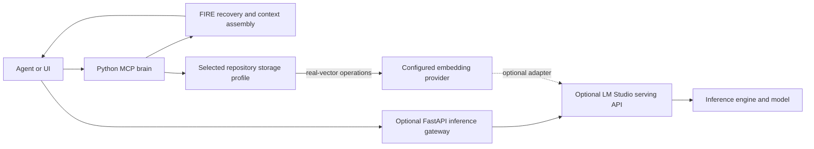

# Stack choices and persistent context — October 16, 2026

Status: researched engineering recommendations and current-source findings. The user
requested this record and a roadmap. This work changes documentation only. Component
selection, implementation, deployment and measured acceptance are separate states.

## Recommended direction

Keep the Python repository-intelligence services, their MCP interface and the separate
optional FastAPI inference proxy. Retain the explicit embedded and service-backed
storage profiles. Use LM Studio as an optional development/model-serving adapter.
Develop persistent context by joining durable originals, revisioned task checkpoints,
targeted retrieval and a bounded recent-message window through the existing context
builder. Evaluate success by recovery and investigation outcomes.

A ring buffer is useful for the recent-message window and possibly rolling numeric
metrics. It cannot preserve everything it overwrites or increase a model's attention
capacity. The product target is **persistent context with bounded working sets**.
Storage capacity, retention, retrieval recall, latency and model input remain finite.
Even the StreamingLLM authors distinguish processing an ongoing stream from extending
the attention window or long-term recall. [StreamingLLM FAQ](https://github.com/mit-han-lab/streaming-llm#faq).

The [implementation roadmap](persistent-context-roadmap.md) orders the work and defines
acceptance. It is an authorized planning lane alongside the existing delivery roadmap;
it does not replace the next useful investigation with an infrastructure migration.

## Where LM Studio fits in the stack

A solution stack is a combination of application, runtime, storage, serving and
operational components. It can include an AI serving layer without adopting a
traditional acronym. For this project the roles are:

| Layer | Current component or profile | Responsibility |
| --- | --- | --- |
| Client | Coding agents, IDEs, explicit CLI and evidence clients | Own user instructions and tasks; request evidence or generation. |
| Repository service | Python, Starlette MCP brain, HTTP/STDIO tools | Discover/read repository evidence and expose scoped operations. |
| Optional inference gateway | FastAPI `proxy:app` | Validate/forward model requests and opt-in context bundles. |
| Context and continuity | FIRE SQLite checkpoints/originals, shared context builder; legacy memory is a separate path | Preserve scoped state and select bounded evidence with provenance. |
| Local repository storage | One LadybugDB/LanceDB owner and native ts-pack parser | Published graph, source, text/vector retrieval and static facts. |
| Service repository storage | Neo4j and PostgreSQL/pgvector; optional Redis | Existing server-backed graph/retrieval and enabled cache/memory features. |
| AI serving | Optional LM Studio app or separately deployed `llmster` | Host generation/embedding models behind documented APIs. |
| Inference engine and model | Engine such as llama.cpp, MLX or Splash; selected generation/embedding model artifacts | Execute model computation; own runtime attention/cache behavior. |
| Operations | Existing optional OpenTelemetry; deployment-specific supervision and HTTP edge | Observe failures/resources and operate the selected profile. |

This table describes roles, not a requirement to run every component. Text/source
repository reads can work without a model. Generation and embedding providers are
independent choices. A model such as Qwen is an artifact hosted by the serving layer;
LM Studio is not the model itself. See [current architecture](current-architecture.md)
and [embedding direction](embedding-provider-direction.md).

Splash is another inference-engine option, separate from the Qwen model family and
the LM Studio serving interface. Vendor model/hardware support and benchmark claims
do not establish a measured advantage in our investigation workload.
[Official Splash integration](https://lmstudio.ai/blog/splash-engine).

The upstream products have distinct roles: the **LM Studio app** supplies a GUI and
local serving; **llmster** supplies headless serving; **lms** controls either from
the terminal. The vendor documents native APIs and compatibility endpoints for
chat and embeddings. Our supported adapter behavior is narrower than the full vendor
catalog. [Component guide](https://lmstudio.ai/docs/app/basics/lmstudio-vs-llmster-vs-lms),
[compatibility APIs](https://lmstudio.ai/docs/developer/openai-compat).

Keep model identity, output schema, citation, timeout and usage checks in our adapters.
Documented API compatibility does not prove every model supports our exact request.
The [strict embedding adapter](lm-studio.md#strict-embedded-indexing-and-watching) and
[stateless context forwarding](context-provider-forwarding.md) have separate contracts.
No inference-provider change is required for this roadmap.

LM Studio reports loaded context configuration separately from model maximum context.
KV-cache allocation and reuse belong to the inference engine; the proxy chooses which
text/evidence to send. Runtime cache reuse is not a durable source/archive contract.
[Model metadata](https://lmstudio.ai/docs/developer/rest/list),
[load configuration](https://lmstudio.ai/docs/developer/rest/load).
Local serving can operate after models/runtimes are acquired; discovery and asset
downloads still require networking. [Offline operation](https://lmstudio.ai/docs/app/offline).

Distribution is a separate decision. The desktop terms checked on October 16 are
dated August 23, 2026 and describe personal/internal-business use with restrictions
on redistribution and service-bureau/ASP/SaaS use. This is not a blanket permissive
distribution license. `lms` and `mlx-engine` have separate MIT licenses; a standalone
llmster distribution license was not established in this research. Review the terms
applicable to the exact artifact/deployment and each model before bundling or customer
hosting. [Desktop terms](https://lmstudio.ai/app-terms),
[`lms` license](https://github.com/lmstudio-ai/lms/blob/main/LICENSE),
[`mlx-engine`](https://github.com/lmstudio-ai/mlx-engine).

## Dictionary findings and component decisions

The open macOS Dictionary app was displaying Wikipedia. LAMP and LYME articles and
the broader Solution stack list were read; selecting LEAP resolved to that broader
list. These definitions describe combinations, not measured recommendations for this
repository. The following decisions are engineering judgments based on the present
workload and primary project documentation.

| Dictionary family | Meaning or relevant idea | Decision for rest_proxy |
| --- | --- | --- |
| LAMP / LAPP / LEMP / LLMP; MAMP / WAMP / WIMP / XAMPP variants | OS, HTTP server, database and application-language combinations. LAPP uses PostgreSQL; server/OS variants substitute components. | Retain Python and the selected existing storage. Add an HTTP edge only for a concrete deployment requirement. An acronym is not a reason to add MySQL, PHP or another runtime. |
| MEAN / MERN / MEVN / PERN; MLVN and WISAV/WIPAV | Web-application combinations with different databases, runtimes and frontend frameworks. | A future React/Vue interface can call existing APIs. Replacing the evidence backend is not a prerequisite to a UI. |
| GRANDstack | GraphQL, React, Apollo and Neo4j. | Conditional graph-exploration UI/API option. Preserve scope, authorization and evidence semantics rather than exposing the graph indiscriminately. |
| Jamstack | Decoupled/prebuilt frontend with API-backed behavior. | Useful for documentation or a separate interface when that deliverable exists. |
| LEAP | Linux, Eucalyptus, AppScale and Python; infrastructure/PaaS composition. | Defer: no current requirement for its cloud platform abstractions. |
| LYME / LYCE | Linux, Yaws, Mnesia/CouchDB and Erlang. | Borrow supervision/failure-isolation principles if useful. An Erlang/database rewrite has no demonstrated benefit here. |
| Python/Django, Java/Spring, Ruby/Rails; GLASS / OpenACS | Alternative application/framework ecosystems. | Keep current application boundaries. Reconsider only for a concrete product capability that outweighs integration cost. |
| ELK | Elasticsearch, Logstash and Kibana for search/log analysis. | Conditional operational log-search system. Existing evidence retrieval and OpenTelemetry do not require it. |
| PLONK | Prometheus, Linkerd, OpenFaaS, NATS and Kubernetes. | Evaluate individual needs, starting with telemetry visibility. Mesh, orchestration and messaging are not one mandatory installation. |
| SMACK / MARQS | Distributed data-processing/messaging/actor combinations. | Defer until a measured distributed workload requires them. |
| BCHS / NMP / WINS / WISA / XRX / T-REx and Ganeti | Other application, data or infrastructure combinations from the list. | No identified requirement warrants switching to these bundles. |

Primary checks supporting these decisions:

- An HTTP edge can front the existing application: [Apache reverse proxy](https://httpd.apache.org/docs/2.4/howto/reverse_proxy.html)
  and [Caddy automatic HTTPS](https://caddyserver.com/docs/automatic-https). Remote
  deployment still needs application access control and transport acceptance.
- [Neo4j GraphQL](https://neo4j.com/docs/graphql/current/) generates APIs over a graph;
  [Jamstack](https://jamstack.org/what-is-jamstack/) separates frontend delivery from APIs.
  Neither establishes better repository evidence or requires adopting the whole bundle.
- [Eucalyptus](https://github.com/eucalyptus/eucalyptus) and [AppScale](https://github.com/AppScale/gts)
  address private-cloud/App Engine compatibility. The original repositories' lifecycle
  notices are not proof of the status of every fork or distribution.
- [Yaws](https://github.com/erlyaws/yaws) and [Mnesia](https://www.erlang.org/doc/apps/mnesia/mnesia_overview.html)
  are Erlang-oriented. [OTP supervision](https://www.erlang.org/doc/system/sup_princ.html)
  supplies explicit child ownership and restart limits; it is a design reference.
- [Elastic Stack](https://www.elastic.co/elastic-stack) is an operational search/log
  option. [Prometheus OTLP ingestion](https://prometheus.io/docs/guides/opentelemetry/)
  is an alternative metrics destination when explicitly configured. Our current
  telemetry has no public `/metrics` endpoint; this research enabled no collector.

## What the trading rings actually implement

Source inspection used Trader1 HEAD `123c88434c77d32b3599ca72493edc09f5dab4ad`
and its current authored source. Its index reported no indexed files; bounded native
reads were used. No extension was built, installed or executed. Cross-repository
paths and hashes are recorded in the [research receipt](../benchmarks/reports/2026-10-16/stack-context-research.json).

| Source in Trader1 | Implemented mechanism | Reuse implication |
| --- | --- | --- |
| `pgExt/micro_ext/micro_ext.c:311,343` | Last-W numeric impact samples; subtract evicted value from sum/sum-of-squares, insert and advance modulo W. O(1) update, O(W) storage. | Transfer the bounded-window idea to recent metrics or message references when needed. It is not a conversational archive. |
| `pgExt/xcorr_ext/xcorr_ext.c:400` | Ring-backed cross-correlation with a loop over the configured lags. | Update cost remains O(max_tau); ring storage alone does not make the complete calculation O(1). |
| `pgExt/winfeat_ext/winfeat_ext.c:1422,2587` | P² quantile sketch plus ring/validity state; approximate removal and periodic rebuild. | Quantile approximation and replay behavior need explicit acceptance before operational reuse. |
| `pgExt/micro_ext/micro_ext.c:814,965` | `_stack` helpers decode aggregate state into local C structs. | These are not task-memory LIFO stacks or a shared-memory messaging system. |

The Trader1 catalog is not uniform runtime evidence: `c_lag_ext/lag_ext--1.0.sql:243`
marks `xcorr_argmax_float8` unimplemented. Its window declaration at lines 263–271
uses `INVFUNC`; PostgreSQL 17 documents moving aggregates using `MSFUNC`, `MINVFUNC`
and `MSTYPE`. SQL wiring requires verification before reuse.
[PostgreSQL moving aggregates](https://www.postgresql.org/docs/17/xaggr.html#XAGGR-MOVING-AGGREGATES).
Trader1's `micro_ext/README.md:17` also distinguishes approximate rolling monitoring
from composable training/replay aggregates. No performance result transfers automatically.

Keep these terms separate:

| Term | Role here |
| --- | --- |
| Ring / rolling buffer | Bounded ordered working set; old entries may leave it. |
| Work queue | Dispatch/backpressure discipline; claims, retries and durability are additional contracts. |
| Key-value store | Access by key; this alone defines no archival or review guarantees. |
| Model KV cache | Inference-engine attention tensors; a PostgreSQL buffer does not manage them through an HTTP API. |
| Consistent-hash ring | Placement of keys across nodes, a separate distributed-storage concern. |

For an in-process prototype, Python's [deque](https://docs.python.org/3.14/library/collections.html#collections.deque)
already supplies bounded recent storage. Its automatic max-length eviction needs an
explicit archive/eviction coordinator; it does not acknowledge persistence. Redis
can remain an optional cache. A native PostgreSQL extension is deferred until profiling
identifies a significant SQL-aggregation bottleneck and exact build/ordering/serialization
compatibility is demonstrated.

## Current context foundations and verified gaps

Inspection used rest_proxy HEAD `da67d5d201cd637b6f07b2acf88dbcd1ff3120e4`
plus the existing working tree, not a clean published release. The receipt binds code
hashes. This documentation work made no model call or runtime configuration change.

| Surface | Current source behavior | Continuity limit / next gate |
| --- | --- | --- |
| Recent history | [store_core.py](../memory/store_core.py), `append_recent_turn`: Redis RPUSH/LTRIM, default 20 records, seven-day TTL. Legacy handler truncates cached user/assistant content to 500 characters. | Already a bounded-window foundation, not full originals. Trimming is independent of durable acknowledgment. |
| Legacy automatic persistence | [handlers_memory.py](../proxy/handlers_memory.py), `_persist_memory_best_effort`, calls [store_graph_ops.py](../memory/store_graph_ops.py), `insert_turns_batch`. Actual conversation-turn writes go to Neo4j despite older Postgres comments. | Best-effort; cached continuations can skip persistence; Redis is updated first. Streaming helper records response IDs but has no matching memory-persistence hook. Complete transcript retention is not established. |
| Legacy scope | `_derive_session_id` can share a bucket by sanitized/truncated project path; `assemble_memory` takes the first colon-separated component for project preferences. | Namespace and project identity can be confused. Require explicit project/session/task scope for the new continuity path. |
| Summary and injection | [summary.py](../memory/summary.py), `_merge_summary_dicts`, puts prior items before new ones under a section cap; legacy injection uses character limits and last-N slicing. | New facts can be omitted; slicing can separate tool calls/results. Summaries are navigation, not original evidence or authority. |
| Durable FIRE state | [fire_store.py](../memory/fire_store.py): private SQLite, revision comparison, hashed originals, corrections, expiry/deletion and paged recovery. Save acknowledges `stored` after commit. | Explicit snapshots, not an append-only transcript journal. Originals are capped at 128,000 bytes per snapshot; retention defaults to one day and is capped at 30 days. Do not silently turn this into an unlimited archive. |
| Recovery adaptation | [fire_context.py](../memory/fire_context.py) adapts one consistent checkpoint/original snapshot into cited historical candidates. | Current-source hashes are caller supplied. No automatic client-compaction interception or universal live-file/editor validation. |
| Shared context budget | [context_bundle.py](../memory/context_bundle.py) counts the canonical request plus reserves, preserves whole messages/citations, rejects incomplete tool exchanges and reports omissions. | Default accounting is UTF-8 bytes; tokenizer/model/chat-template correspondence is not attested. It does not automatically discover every needed memory. |
| Optional provider forwarding | [context_forwarding.py](../proxy/context_forwarding.py) recounts serialized request data and checks loaded model capacity. | Opt-in LM Studio route; stateless, text-only and non-streaming; no tool execution. This is distinct from legacy injection. |

The October 6 [FIRE recovery](fire-durable-continuity.md),
[bundle](context-bundle-contract.md) and [forwarding](context-provider-forwarding.md)
receipts establish their recorded fixture behavior. Current forwarding source changed
after its real-model receipt through shared HTTP-client ownership; that historical
run is not a current-tree rerun. October 12 telemetry and October 14–15 evidence/corpus
checks cover their own layers. They do not establish automatic conversational recall.
The separate October 16 PR #4 candidate's 113 offline checks and one pinned automated
provider fixture are task-review acceptance, not this proposed context pipeline.
Its retained acceptance identities and summary are included in the
[research receipt](../benchmarks/reports/2026-10-16/stack-context-research.json),
separately from the earlier primary-checkout 108-test policy report.

## Proposed integration and adoption choices

Use explicit archive ingestion with stable event IDs, exact scope, ordered sequence,
source hashes and a committed acknowledgment. The recent window should retain complete
exchanges or references to committed originals. Advance an archive watermark only
after durable commit; replay duplicate events idempotently. Keep summaries and retrieval
indexes rebuildable from permitted originals. Reuse FIRE checkpoint/correction contracts;
first decide whether to extend its bounded snapshot store or add an append-only event
table under the same local state ownership. This storage/schema decision is still open.

Do not promise unlimited retention from finite storage. Set explicit quotas, retention
and deletion policy. Archive operations need visible accepted/unavailable/full outcomes.
When persistence fails, inference remains usable with a continuity-degraded/loss status;
do not acknowledge unsaved history as recoverable or silently grow an unbounded buffer.
This resolves the tradeoff between optional integrations and archival claims.

Pack mandatory instructions/current goal, checkpoint state, complete recent exchanges
and selected historical/repository evidence under a whole-request budget. Protect
caller instructions; recovered text stays labeled evidence. Retrieve by exact IDs,
scope and lexical search first, then use graph/vector retrieval where the question
benefits. Preserve correction/supersession and provenance. Revalidate current-code
claims separately from historical conversation evidence.

Keep the current storage profiles. For local continuity, SQLite is the first candidate
because it already owns explicit FIRE state; its transaction/backup/concurrency behavior
must be tested for the new append workload. No WAL-mode change is implied. The server
profile can evaluate PostgreSQL transactions for an actual multi-client requirement;
Neo4j/LanceDB indexes remain retrieval projections rather than the sole archive.

Retain LM Studio for the current internal development baseline. Evaluate alternatives
only for a documented role: [llama.cpp server](https://github.com/ggml-org/llama.cpp/tree/master/tools/server)
for direct engine/distribution control, [MLX LM](https://github.com/ml-explore/mlx-lm)
for a measured Apple Silicon serving need, [FastEmbed](https://github.com/qdrant/fastembed)
for in-process embeddings, or [TEI](https://github.com/huggingface/text-embeddings-inference)
for a dedicated embedding service. None was installed or compared here. Retain model,
tokenizer, pooling/prefix/normalization and truncation identities; equal vector dimensions
do not establish compatibility. Changing encoders requires a new published vector run.

Keep existing optional OpenTelemetry. Add counters for archive acknowledgment/failure,
window eviction, retrieval omissions and context accounting only through finite,
payload-free labels. Prometheus/dashboard integration is conditional on a useful
operational decision. Pool/provider coverage and paid-model usage need their own
measurement. No latency, token-saving or quality gain follows from selecting a ring,
runtime, database or stack name.

## Shadowrocket finding and network boundary

The October 16 UI inspection showed the orange dot beside **REST Proxy TCP + UDP**;
the app's help says the dot marks the default server. Its switch was on and Global
Routing displayed Config. This is a UI observation, not a fresh end-to-end traffic test.

There are two different proxy roles: Shadowrocket/GOST forwards network TCP/UDP, while
the FastAPI inference proxy handles model API requests. The saved
[October 10 gateway evidence](shadowrocket-gateway.md) records SOCKS5 loopback 18081,
HTTP fallback 18080 and local Shadowrocket app proxy 1082. Those are historical
configuration/test observations; no routing, DNS, listener or service changed here.
The MCP brain normally uses 8001, the optional inference proxy 8000 and LM Studio's
documented server default is 1234. The Compose MCP profile also defaults to host 8000;
choose distinct ports when combining profiles. No part of this network path makes
encrypted traffic into a conversation archive or enlarges model context.

## Evidence and unresolved choices

The [research receipt](../benchmarks/reports/2026-10-16/stack-context-research.json)
records inspected code identities and source URLs. External documentation was checked
October 16, 2026; product terms/features can change. Dictionary descriptions were
treated as source material, not instructions to install software.

Open decisions are the append/archive schema and retention contract, client event
capture boundaries, tokenizer/template attestation, retrieval recovery quality and
the exact distribution artifact/licenses. The roadmap supplies gates for these.
No service, model, dependency, database, index or task state was changed by this work;
no new performance or recall acceptance is claimed.
